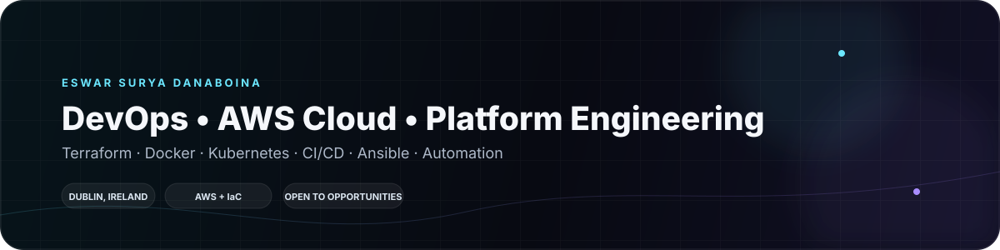

  

# Eswar Surya Danaboina

**DevOps & Cloud Engineer** · AWS · Kubernetes · Terraform · Dublin, Ireland · Stamp 1G  
Open to DevOps, SRE, Cloud and GCP Engineer roles in Ireland · [Portfolio site](https://eswarsurya.github.io/eswar-portfolio/)

I've worked in DevOps since 2021: a 10-month internship at Signovate Technologies, then almost three years as a DevOps Engineer at Blockstars, supporting AWS infrastructure, Jenkins and GitHub Actions pipelines, Docker and Kubernetes deployments, and Terraform and Ansible automation. After an MSc in Data Analytics in Dublin, I built the portfolio below to show how I work today: everything is tested in CI, and nothing claims more than it proves.

## DevOps portfolio

All projects live in **[devops-portfolio](https://github.com/eswarsurya/devops-portfolio)**, each with its own GitHub Actions workflow.

| Project | What it shows |
| --- | --- |
| [Jenkins Pipeline](https://github.com/eswarsurya/devops-portfolio/tree/main/projects/jenkins-pipeline) | Jenkins configured as code. Test, build, scan, staging, approval, production, with health checks and automatic rollback. CI proves a broken release never reaches production. |
| [Grid Signal (Google Cloud)](https://github.com/eswarsurya/devops-portfolio/tree/main/projects/gcp-grid-signal) | Live Irish grid carbon intensity on GCP: Cloud Run, Cloud Run Jobs, Scheduler and Firestore in Terraform, keyless deploys from GitHub, uptime alerts, a budget, and a carbon-aware CI gate. |
| [Kubernetes GitOps Platform](https://github.com/eswarsurya/devops-portfolio/tree/main/projects/k8s-gitops-platform) | Helm chart with autoscaling, disruption budget and network policy, deployed by Argo CD (app-of-apps). CI installs it on a 3-node kind cluster, runs `helm test`, upgrades and tests again. |
| [Terraform AWS Web Stack](https://github.com/eswarsurya/devops-portfolio/tree/main/projects/terraform-aws-webstack) | Terraform modules for a two-AZ VPC, ALB and Auto Scaling Group, S3 remote state with locking, `terraform test` with a mocked AWS provider, Trivy IaC scan. |
| [Docker CI/CD Pipeline](https://github.com/eswarsurya/devops-portfolio/tree/main/projects/docker-cicd-pipeline) | Lint, tests, container smoke test, Trivy image scan, push to GHCR, and an optional EC2 deploy behind a manual approval gate. |
| [Rail Pulse](https://github.com/eswarsurya/devops-portfolio/tree/main/projects/rail-pulse) | Live Irish Rail punctuality run as an SRE service: 85% SLO, Prometheus alerts unit-tested with promtool, Grafana, and a daily check that the live API hasn't changed. |
| [AIOps Triage Agent](https://github.com/eswarsurya/devops-portfolio/tree/main/projects/aiops-triage-agent) | A Prometheus alert starts a Claude agent that investigates Kubernetes with read-only tools. Any fix it proposes runs only after a human approves it. |
| [LLM Gateway](https://github.com/eswarsurya/devops-portfolio/tree/main/projects/llm-gateway) | Control plane for company Claude API use: team keys, rate limits, budgets, PII redaction, caching, cost metrics. |
| [Ansible Linux Hardening](https://github.com/eswarsurya/devops-portfolio/tree/main/projects/ansible-linux-hardening) | SSH hardening, fail2ban and a host audit script. CI applies the role to a fresh Ubuntu 24.04 machine and re-runs it to prove nothing changes. |

Also in the repo: CI Log Doctor (explains failed builds on the pull request), a read-only MCP server with SSRF protection, and verified, encrypted S3 backups in Bash.

## Toolbox

- **Cloud:** AWS (EC2, S3, VPC, IAM, RDS, Route 53, ALB, Auto Scaling, CloudWatch); Google Cloud (Cloud Run, Scheduler, Firestore, Artifact Registry, IAM, Workload Identity Federation)
- **IaC & config:** Terraform, Ansible
- **Containers:** Docker, Kubernetes, Helm, Argo CD
- **CI/CD:** GitHub Actions, Jenkins, GHCR, Trivy, gitleaks
- **Observability:** Prometheus, Alertmanager, Grafana, ELK, SLOs
- **Scripting:** Bash, Python (FastAPI, pytest), Linux administration
- **AI automation:** Claude API (tool use, agents), MCP servers

## Data and ML background

From my MSc Data Analytics: [anomaly detection in human vitals (thesis)](https://github.com/eswarsurya/human-vitals-anomaly-detection-thesis), the same model served as a [Dockerised Flask API](https://github.com/eswarsurya/human-vitals-anomaly-api), and [more Master's projects](https://github.com/eswarsurya/eswarsurya/tree/main/masters-projects) (ML, BI dashboards, Python and SQL).

## Education

**MSc Data Analytics (2:1)**, Dublin Business School · 2025–2026  
**B.Tech Computer Science & Engineering**, Vel Tech · CGPA 8.39/10

## Contact

[Portfolio](https://eswarsurya.github.io/eswar-portfolio/) · [LinkedIn](https://www.linkedin.com/in/eswarsurya76/) · [eswardanaboina@gmail.com](mailto:eswardanaboina@gmail.com)
